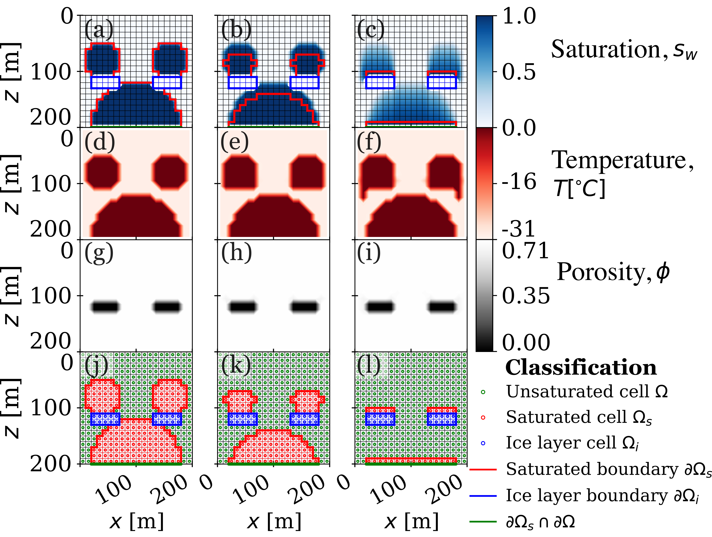
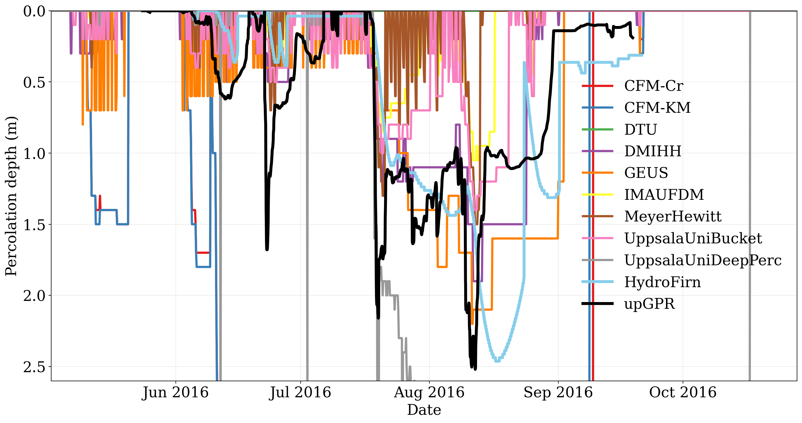

# HydroFirn

## A numerical model for large-scale multidimensional firn hydrology

HydroFirn is a conservative, multidimensional, multiphase thermo-hydrologic
model for meltwater transport through firn. It couples water mass transport,
heat transport, and phase change while allowing the domain to transition
dynamically among:

- gravity-driven unsaturated flow;
- pressure-driven saturated flow and firn aquifers; and
- impermeable ice layers formed by refreezing and pore close-off.

The model is developed in the companion article, currently under **minor
revision at the *Journal of Glaciology***:

> Shadab MA, Adhikari S, Stevens CM, Rennermalm AK, Xiao J, Hesse MA, and Maxwell RM.
> **“HydroFirn: A numerical model for large-scale multidimensional firn
> hydrology.”** *arXiv preprint* [arXiv:2604.11488](https://arxiv.org/abs/2604.11488).
> 2026 Apr 13.

This repository contains the manuscript experiment scripts, numerical
operators, DYE-2 percolation-depth data, and the supplementary media shown
below.

---

## HydroFirn in action: coupled variably saturated flow, heat transfer, and phase change



This schematic corresponds to **Figure 3** of the manuscript. Three initially
saturated water bodies drain
through otherwise dry firn at -30 °C in a 200 m × 200 m domain containing two
impermeable ice layers. Columns show the evolving solution at 0, 1, and 24
hours; rows show water saturation, temperature, porosity, and the numerical
classification used by CIMPEC. Saturated cells and their moving boundaries
are shown in red, impermeable ice-layer cells and boundaries in blue, and
unsaturated cells in green. The example illustrates how HydroFirn confines
the implicit pressure solve to dynamically identified saturated subdomains
while preventing advective water transport through ice layers.

The associated experiment and plotting code is
[`src/3_schematic_simulation.py`](src/3_schematic_simulation.py).

---

## Supplementary media

### 1. Supplementary Video S1 — firn aquifer migration


https://github.com/user-attachments/assets/55256d24-5765-43b4-b5eb-1ae83ada36b1


The video corresponds to the two-dimensional verification problem in **Figure
5** of the manuscript. It shows the lateral expansion of a
temperate firn aquifer into otherwise dry firn initially at -30 °C, over an
impermeable base, in the no-conduction limit. The animation combines numerical
water saturation, temperature, and porosity with the semi-analytical
solutions. This test exercises lateral saturated flow, advective heat
transport, refreezing, and the moving aquifer boundary.

The associated experiment and plotting code is
[`src/5_gravity_current_Kochina_initialized_without_conduction.py`](src/5_gravity_current_Kochina_initialized_without_conduction.py).

### 2. Supplementary Video S2 — DYE-2 melt season

https://github.com/user-attachments/assets/17093959-fa4c-4cb9-b5b6-4dae68e4a808


The video corresponds to the field-scale experiment in **Figure 6** of the
manuscript. It shows simulated meltwater infiltration and refreezing at
the DYE-2 site in southwest Greenland during the 2016 melt season. The
heterogeneous case superposes a correlated random field with amplitude
`A = 0.05` and horizontal correlation length `θx = 4 km` on the measured
one-dimensional porosity profile. The panels track water saturation,
temperature, and porosity as observed surface forcing warms the firn, drives
percolation, and produces localized low-porosity layers.

The associated experiment and plotting code is
[`src/6_samimi_corr_rnd_field_lateral.py`](src/6_samimi_corr_rnd_field_lateral.py).

### 3. DYE-2 model–observation intercomparison



This image reproduces **Figure 11** of the manuscript. It compares the
instantaneous deepest occurrence of liquid water predicted by HydroFirn with
nine models from the Retention Model Intercomparison Project (RetMIP) and
upward-looking ground-penetrating radar (upGPR) observations. HydroFirn
captures the observed seasonal progression toward an approximately 2.5 m
maximum penetration depth in August, followed by retreat of the liquid-water
front. The spread among models highlights the sensitivity of percolation to
the representation of water transport and retention.

The plotted values are archived in
[`src/Dye-2_16_percolation_depth_data.csv`](src/Dye-2_16_percolation_depth_data.csv),
and the standalone plotting program is
[`src/11_plot_percolation_depth_from_csv.py`](src/11_plot_percolation_depth_from_csv.py).

---

## Model formulation

Firn is represented as a three-phase system of ice, liquid water, and gas. The
primary conserved variables are:

- total water composition, `C` [kg m⁻³]; and
- volumetric enthalpy, `H` [J m⁻³].

Temperature and the ice, water, and gas volume fractions are recovered from
`C` and `H`. Water and enthalpy are advanced using conservative finite-volume
operators on a Cartesian staggered grid.

HydroFirn uses the **Conditionally Implicit Pressure, Explicit Enthalpy and
Composition (CIMPEC)** algorithm:

1. evaluate gravity-drainage fluxes in unsaturated firn;
2. identify saturated cells using the water-saturation threshold;
3. solve the elliptic hydraulic-head equation only on those saturated cells;
4. couple saturated and unsaturated fluxes at their moving interface;
5. advance composition and enthalpy explicitly under the CFL constraint;
6. recover temperature and phase fractions; and
7. suppress water flux through dynamically formed impermeable ice cells while
   retaining conductive heat transport.

Restricting the pressure solve to saturated subdomains makes the formulation
suited to large multidimensional domains containing multiple disconnected
aquifers.

## Manuscript-to-code map

| Manuscript result | Purpose | Repository entry point |
|---|---|---|
| Figure 1 | Enthalpy–composition phase diagram and secondary variables | [`src/1_phase_diagram.py`](src/1_phase_diagram.py) |
| Figure 3 | Dynamic saturated, unsaturated, and impermeable-cell classification | [`src/3_schematic_simulation.py`](src/3_schematic_simulation.py) |
| Figure 4 | One-dimensional infiltration and perched-aquifer validation | [`src/4_firn_infiltration_UKWT.py`](src/4_firn_infiltration_UKWT.py) |
| Figure 5; Video S1 | Two-dimensional cold-firn aquifer migration | [`src/5_gravity_current_Kochina_initialized_without_conduction.py`](src/5_gravity_current_Kochina_initialized_without_conduction.py) |
| Figures 6–10; Video S2 | DYE-2 forcing, correlated heterogeneity, infiltration, and refreezing | [`src/6_samimi_corr_rnd_field_lateral.py`](src/6_samimi_corr_rnd_field_lateral.py) |
| Figure 11 | RetMIP/HydroFirn/upGPR percolation-depth comparison | [`src/11_plot_percolation_depth_from_csv.py`](src/11_plot_percolation_depth_from_csv.py) |

The reusable grid construction, discrete operators, boundary-condition
handling, flux calculations, phase behavior, and linear solves are in
[`Solver/`](Solver/).

## Repository layout

```text
HydroFirn/
├── cover/
│   ├── photos/       # DYE-2 percolation-depth intercomparison
│   └── videos/       # Supplementary Videos S1 and S2
├── Solver/           # Finite-volume grids, operators, fluxes, and solvers
├── src/              # Manuscript experiments, plots, and archived CSV data
├── LICENSE
└── README.md
```

## Python environment

### Exact reference environment

The current research scripts do not contain an original lock file, so their
historical execution environment cannot be recovered exactly from the
repository. For reproducible future runs, use the following **fully pinned
reference environment**:

| Dependency | Exact version | Used for |
|---|---:|---|
| Python | `3.9.14` | Interpreter |
| NumPy | `1.25.2` | Arrays and numerical operations |
| SciPy | `1.11.2` | Sparse matrices, integration, interpolation, and linear algebra |
| Matplotlib | `3.7.2` | Static figures and animations |
| pandas | `2.0.3` | DYE-2, RetMIP, and upGPR tabular data |
| IPython | `8.15.0` | `%matplotlib qt` and the interactive reset used by legacy scripts |

Install exactly these versions in an isolated environment:

```bash
python3.9 -m venv .venv
source .venv/bin/activate
python -m pip install --upgrade "pip==23.2.1"
python -m pip install \
  "numpy==1.25.2" \
  "scipy==1.11.2" \
  "matplotlib==3.7.2" \
  "pandas==2.0.3" \
  "ipython==8.15.0"
```

Animation export additionally requires an `ffmpeg` executable. The archived
MP4 files use H.264 encoding, but `ffmpeg` is not needed to view them or to
generate the static Figure 11 comparison.

### Important execution status

This repository is currently a **research archive associated with the
manuscript**, not yet a clean, one-command software distribution. A fresh
clone does not presently reproduce every simulation because the following
imported project modules are absent:

```text
two_components_aux.py
random_correlated_fields.py
RetMIP_data_analysis.py
colliander_data_analysis.py
Barenblatt_cartesian.py
```


## Quick start: regenerate the intercomparison

From the repository root:

```bash
source .venv/bin/activate
python src/11_plot_percolation_depth_from_csv.py
```

By default, the program reads
`src/Dye-2_16_percolation_depth_data.csv` and writes PNG and PDF versions next
to that file. To choose a different output:

```bash
python src/11_plot_percolation_depth_from_csv.py \
  src/Dye-2_16_percolation_depth_data.csv \
  --output Dye-2_intercomparison.png
```

The legacy simulation scripts prepend `../Solver` to `sys.path` and use
IPython-specific commands. Once their missing auxiliary modules and data
products are restored, run them from `src/` in IPython or Spyder:

```bash
cd src
ipython 4_firn_infiltration_UKWT.py
```

## Scientific scope and assumptions

The manuscript formulation:

- neglects capillary pressure and water vapor transport;
- treats the gas contribution to total enthalpy as negligible;
- uses gravity drainage in unsaturated firn;
- resolves Darcy pressure flow in saturated regions;
- represents impermeable ice through a configurable pore-close-off threshold;
- uses an Eulerian Cartesian grid with a moving firn surface; and
- supports heterogeneous surface forcing and laterally correlated porosity
  fields.

These assumptions should be retained when interpreting the verification
problems and the DYE-2 application.

## Authors

- Mohammad Afzal Shadab — Princeton University
- Surendra Adhikari — Jet Propulsion Laboratory, California Institute of Technology
- C. Max Stevens — University of Maryland / NASA Goddard Space Flight Center
- Åsa K. Rennermalm — Rutgers University
- Jing Xiao — Rutgers University
- Marc A. Hesse — The University of Texas at Austin
- Reed M. Maxwell — Princeton University

Correspondence: Mohammad Afzal Shadab
([mashadab@princeton.edu](mailto:mashadab@princeton.edu)).

## Citation

The article is currently under **minor revision at the *Journal of
Glaciology***. Please use the arXiv citation:

```text
Shadab MA, Adhikari S, Stevens CM, Rennermalm AK, Xiao J, Hesse MA and Maxwell RM.
HydroFirn: A numerical model for large-scale multidimensional firn
hydrology. arXiv preprint arXiv:2604.11488. 2026 Apr 13.
```

## License

HydroFirn is distributed under the terms in [`LICENSE`](LICENSE).
